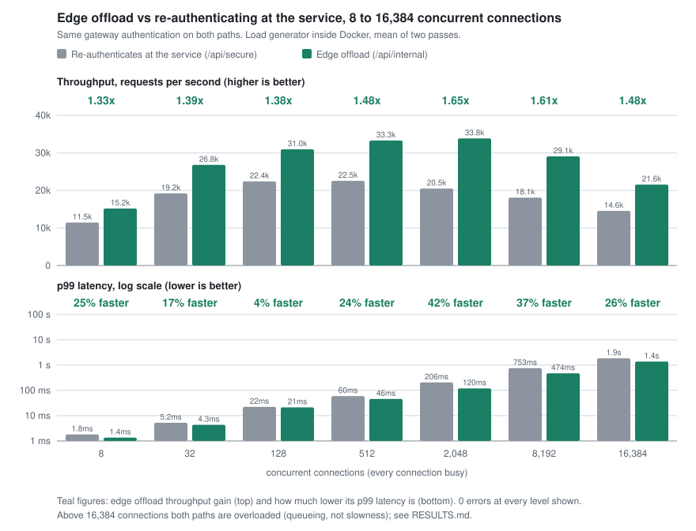

# GatewayForge

[](https://github.com/panoskentros/GatewayForge/actions/workflows/ci.yml)


An API gateway (YARP) in front of two services, secured with Keycloak. It shows two ways to trust a downstream service:

| Route | Pattern | The service... |
|---|---|---|
| `/api/secure/*` | Token relay | validates the JWT and role itself |
| `/api/internal/*` | Edge offload | trusts `X-User-Id`, but only with the gateway's `X-Gateway-Key` |

```
Client ──JWT──▶ Gateway ──▶ Secure service
                   │    └──▶ Internal service
                   └──▶ Keycloak ──▶ Postgres
```

## Run

```bash
cp .env.example .env      # fill in the values
docker-compose up -d --build
```

- Gateway: <http://localhost:5100>
- Keycloak: <http://localhost:8080>

```bash
TOKEN=$(curl -s -d client_id=gateway-client -d username=testuser -d password=123456 \
  -d grant_type=password http://localhost:8080/realms/gateway-forge/protocol/openid-connect/token \
  | python3 -c 'import sys,json;print(json.load(sys.stdin)["access_token"])')

curl -H "Authorization: Bearer $TOKEN" http://localhost:5100/api/secure/secure-data
curl -H "Authorization: Bearer $TOKEN" http://localhost:5100/api/internal/internal-data
```

`testuser` / `123456` is a dev-only user seeded from `keycloak/import/gateway-forge-realm.json`.

## What it enforces

- JWT signature, issuer, audience and expiry are validated.
- Realm roles `secure-user` and `internal-user` gate each route.
- The gateway strips any client-supplied identity headers and sets its own.
- Services and the database sit on internal-only Docker networks.
- Per-user rate limiting and correlation ids on every request.

## Results

Edge offload (`/api/internal`) compared with re-authenticating at the service (`/api/secure`). Both go through the same gateway authentication.



| Connections | Secure req/s | Offload req/s | Gain | p99 secure / offload | p99 faster |
|---|---|---|---|---|---|
| 8 | 11,455 | 15,188 | 1.33x | 2 / 1 ms | 25% |
| 128 | 22,421 | 30,954 | 1.38x | 22 / 21 ms | 4% |
| 2,048 | 20,498 | 33,844 | 1.65x | 206 / 120 ms | 42% |
| 8,192 | 18,092 | 29,074 | 1.61x | 753 / 474 ms | 37% |
| 16,384 | 14,558 | 21,562 | 1.48x | 1,857 / 1,378 ms | 26% |

- Edge offload is 1.3x to 1.65x faster, and the gain grows with concurrency. It stays flat as total volume grows.
- The p99 gain is smallest at 128 connections (4%). That is expected, not a bug: there both paths are close to CPU-bound and queue to almost the same tail, so the second JWT validation shows up in throughput (1.38x) but barely in the tail. It is largest at 2,048 connections (42%), where the re-authenticating path starts to queue.
- The gateway held up to 45,000 to 56,000 concurrent connections. 0 errors up to 32,768 in every run; 50,000 is at the edge; the gateway was OOM-killed at 60,000 in a 7.7 GB Docker VM.
- Past about 16,000 busy connections the system is up but queueing (seconds of latency), and the load generator is itself a bottleneck.
- Method, per-pass data and caveats: [RESULTS.md](GatewayForge.LoadTest/RESULTS.md).

## Test

```bash
dotnet test GatewayForge.Tests
```

## Load simulation

`GatewayForge.LoadTest` measures how much faster edge offload is than re-authenticating at the service.

From inside Docker (use this for high concurrency; the Mac's port-forwarding and 16,384-port limit are out of the way):

```bash
docker-compose -f docker-compose.yml -f docker-compose.benchmark.yml up -d --build
docker-compose -f docker-compose.yml -f docker-compose.benchmark.yml run --rm loadtest \
  --mode sweep --levels 8,128,2048,16384,32768,50000 --duration 10
```

From the host (up to a few thousand connections):

```bash
dotnet run -c Release --project GatewayForge.LoadTest -- --mode compare --rounds 6 --duration 10
dotnet run -c Release --project GatewayForge.LoadTest -- --mode users --users 100
dotnet run -c Release --project GatewayForge.LoadTest -- --mode volume --requests 500000 --concurrency 128

docker-compose up -d
dotnet run -c Release --project GatewayForge.LoadTest -- --mode noisy --users 50 --duration 30
dotnet run -c Release --project GatewayForge.LoadTest -- --mode flood --duration 10
```

`users` and `noisy` create throwaway Keycloak users (`loadtest-*`, using the admin credentials in `.env`) and delete them afterwards.

Options: `--concurrency 64 --users 50 --rounds 1 --requests 500000 --levels 16,64,256,1024 --duration 15 --warmup 3 --ramp SECONDS --think MS --gateway URL --keycloak URL --user NAME --password PASS --admin-user NAME --admin-password PASS`.

The benchmark override raises the rate limit and turns request logging off. Memory is the practical ceiling: very high levels may need more than the default Docker Desktop VM allocation.
